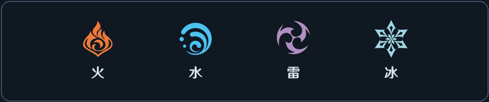

# 元素系统

## 使用指南
- mod菜单：打开mod菜单，可选择一些设置
  - 难度：为了平衡本mod带来的数值加强，准备了难度等级供玩家选择，难度通过削减玩家直接伤害实现，极限和困难还会削减反应附伤。难度包含：
    - 极限 - 玩家减伤 65% ，反应附伤降低35%
    - 困难 - 玩家减伤 55% ，反应附伤降低15%
    - 平衡 - 玩家减伤 50%
    - 普通 - 玩家减伤 20% - 默认选择
    - 简单 - 无
  - 血条：可选择隐藏本mod血条，隐藏后，若添加了Enemy Health Bar 这一模组，将会根据该模组的血条位置来显示敌人元素附着和Buff
  - 特效大小、是否染色、是否允许局内更换元素配置等均可调。

- 第一页：元素配置。在此处配置骨钉、剑技和法术的元素类型。当mod菜单选择允许局内更换元素配置后，可随时在此处调整。
- 第二页：护符配置。可在此配置本mod专属护符，与原版护符不冲突，通用、增幅、剧变、生存四类护符各有槽位，增幅的槽位可改为选择剧变。
- 按下F5或者通过背包翻页可进入「元素系统」，**当处在本界面时，游戏会暂停**。
- 打开此界面后，按数字键1或者手柄梦之钉键，会直接跳转到元素配置页面，方便局内快速切换
- 在神居 Boss 房间以及门内战斗中打开时，**自动显示当前 Boss 的机制条目页**。
