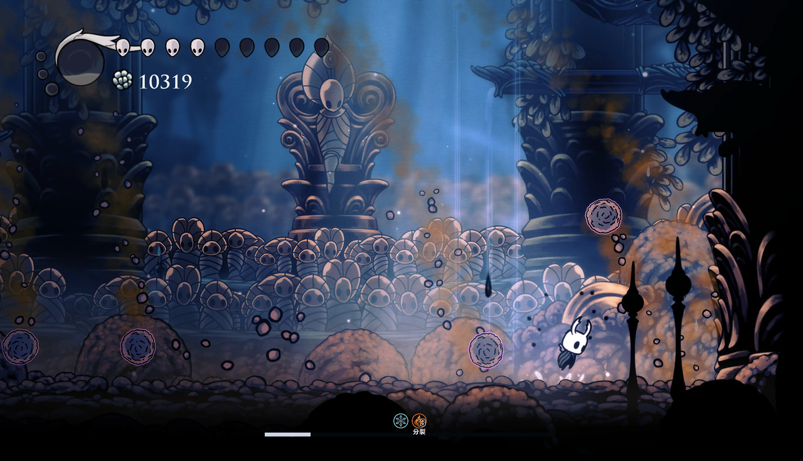

# 粪虫防御者

- 每颗粪球随机一种元素，使用元素轮廓提示。
- 超载可直接触发倒地。弹球形态开始时自附普通 1U 雷，弹跳与移动加快 30%。
- 每次超载实际倒地后，8 秒内不能再次由超载击倒；超载伤害仍生效。

- 每次由超载实际触发倒地，永久获得一层增益，最多三层。
- 血条上方显示分裂增益的当前层数。
- 投出的粪球按投掷时的增益层数 n，在首次碰地、墙、天花板时分裂为 n+1 个半尺寸小球。分裂后的小球不会再次分裂。
