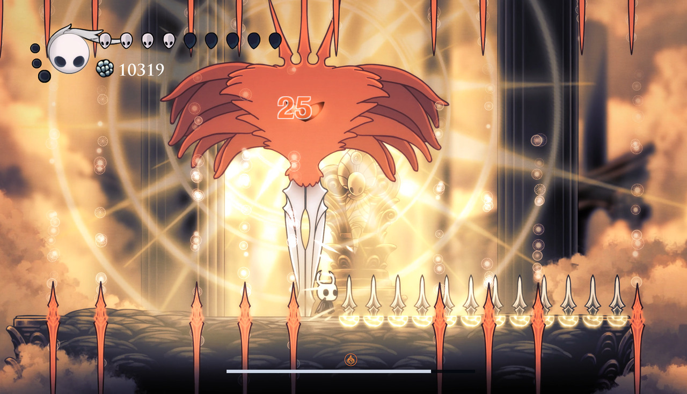

# 无上辐光

- 光球随机元素，水平移动的竖直光墙为火。身体接触与原版阶段逻辑保持。
- 首次受到元素伤害后，本体染上该元素并获得对应的无限附着，持续 10 秒；光剑和中心发射的光线使用该元素。

- 染色期间首次发生反应时，记录这次反应的后手元素。
- 记录后，光剑、光线在造成伤害前先清除玩家附着，再施加记录的后手元素，随后造成染色元素伤害，相当于将玩家首次反应的顺序反转后反击。
- 10 秒结束后，本体染色、固有附着和后手记录一同清除，下次可以重新染色和记录。
