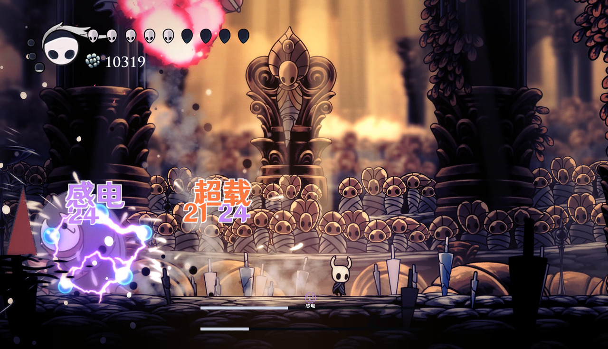

# 感电

## 对敌效果
- 水、雷按 1:1 消耗，为敌方添加持续的雷属性伤害。
- 基础持续 {{Reactions.EnemyElectroSeconds}} 秒，每 {{Reactions.EnemyElectroInterval}} 秒跳伤一次。
- 每跳基础附伤为 **{{Reactions.EnemyElectroNailScale}} × 未减伤的基础骨钉伤害**，向下取整。基础骨钉 21 时每跳 9。
- 重复感电补满剩余跳数并重置感电伤害，不会延后已经安排的下一跳。
- 感电后续的持续伤害不会视为发生了反应，也不会为任何buff计数（例如不会消耗「超导破绽」）。

## 玩家受到的效果
- 每 {{Reactions.PlayerElectroInterval}} 秒扣 1 面具，共 **{{Reactions.PlayerElectroTicks}} 次**；默认在第 4、8、12 秒扣血。
- 受到一次真实的外部伤害会解除持续伤害。
- 感电自身扣血不会清除后续跳伤。无敌帧暂时挡住到期的一跳会在无敌帧结束时结算，不会消失。
