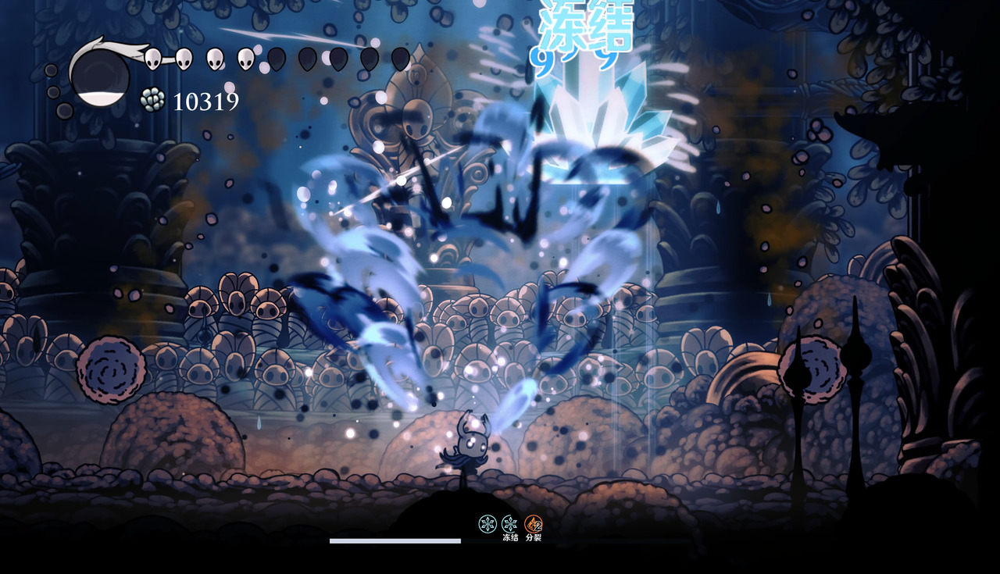
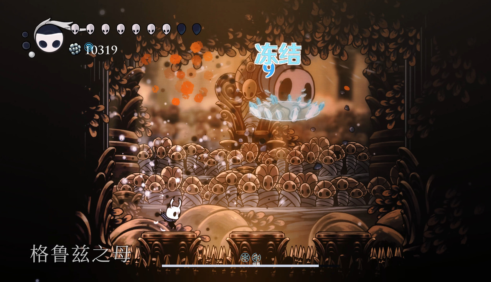

# 冻结与结霜

## 对敌效果

- 非霸体的目标进入硬冻结，首次基础持续 **{{Reactions.FreezeSeconds}} 秒**，运动停止并显示完整冰块；随后进入结霜，两段合计 **{{Reactions.FrostSeconds}} 秒**。
- 硬冻结期间，冻结的衰减速度持续提高，使短时间内的下一次硬冻结更短。但不影响后续结霜的持续时间。
- 退出硬冻结后，冻结的衰减速度则会逐渐恢复到初始水平，但结霜期间衰减速度缓慢恢复，离开结霜后恢复更快。冻结状态下再次触发冻结会刷新冻结持续时间，但不会重置衰减速度。结霜期间再次触发水冰反应，可重新进入硬冻结；霸体目标则刷新结霜。

- 霸体的目标进入结霜，基础持续 **{{Reactions.FrostSeconds}} 秒**，行动速度变为原来的 {{Reactions.FrostSpeed}} 倍，显示结霜状态效果。

- 冻结 / 结霜状态下的敌人受到的雷、火元素攻击会「视为与冰元素反应」并解除冻结和结霜状态。

- 冻结不会留下普通冰附着；冻结／结霜仅在火、雷反应时提供虚拟冰。只持续施加水不能续冻，重新冻结需要实际的新冰来源。
- 火、雷反应或碎冰会同时清除冻结与结霜，不会再接上原定结霜尾段。
- 状态刷新与火、雷反应仍须满足该招式的附着冷却和次数限制。

## 玩家受到的效果
- 小骑士不会被完全定住，而是结霜 **{{Reactions.PlayerFreezeSeconds}} 秒**。
- 移动速度变为 {{Reactions.PlayerMoveScale}} 倍，攻击速度变为 {{Reactions.PlayerAttackSpeedScale}} 倍。
- 状态期间黑波、黑吼、黑砸按对应的白色法术施放；状态结束后恢复。
