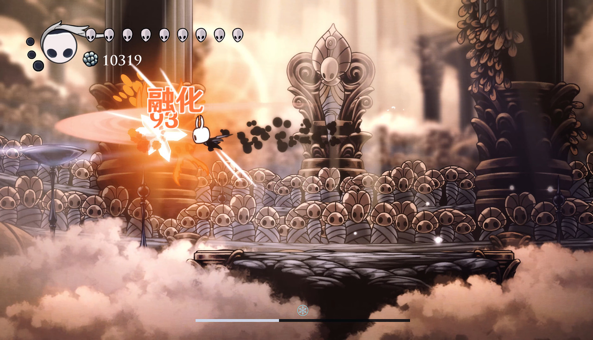

# 融化

## 对敌效果
| 目标已有 | 后来的攻击 | 直接伤害倍率 | 底元素消耗 |
|---|---|---|---|
| 冰 | 火 | {{Reactions.ForwardMultiplier}} 倍 | 每 1U 攻击消耗 {{Reactions.ForwardConsumption}}U |
| 火 | 冰 | {{Reactions.ReverseMultiplier}} 倍 | 每 1U 攻击消耗 {{Reactions.ReverseConsumption}}U |

与蒸发一样，倍率作用于减伤后的直接伤害。

## 玩家受到的效果
- 冰附着时受到火攻击：正向增幅，基础伤害翻倍。
- 火附着时受到冰攻击：逆向增幅，基础伤害加 1。
- 超载易伤与增幅同时存在时取较大值，不相乘。
