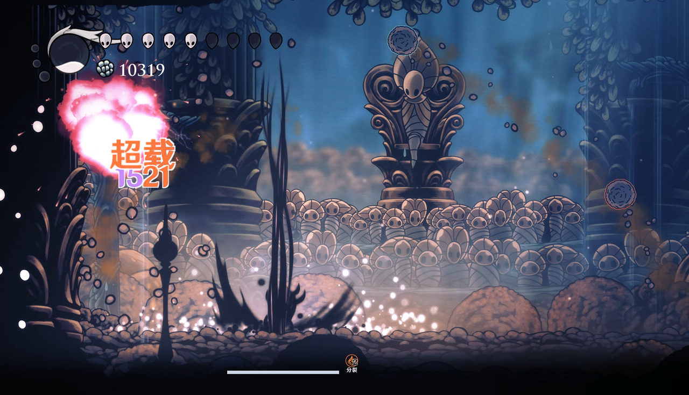

# 超载

## 对敌效果
- 产生一次火元素爆炸，基础附伤为 **{{Reactions.OverloadNailScale}} × 未减伤基础骨钉伤害**。
- 爆炸半径 {{Reactions.OverloadRadius}}，带沉重击退效果；目标本身不吃击退时不会被强行推走。
- 超载爆炸产生的伤害不视为一种反应，也不会附着，不会消耗任何buff的计数。
- 部分 Boss 可被超载破盾、提前打倒或解除保护，具体见各自条目。

## 玩家受到的效果
- 触发超载后获得持续 **{{Reactions.PlayerOverloadSeconds}} 秒**的易伤状态。
- 状态期间后续受到的直接伤害翻倍，受伤不会清除此状态。
- 触发超载的这一击不会因为刚获得的超载状态再翻倍。
- 状态期间又受到蒸发或融化时，取超载与增幅中较大的伤害，不连续相乘。
