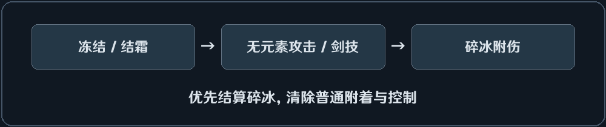

# 碎冰

## 对敌效果
目标处于硬冻结或结霜期间，使用**无元素直接攻击或任意剑技**触发碎冰。

- 追加 {{Reactions.ShatterNailScale}} × 未减伤基础骨钉伤害，属于无元素附伤。
- 碎冰优先于该次攻击原本可以触发的其他元素反应。
- 触发碎冰时解除冻结和结霜，不清除身下的元素附着。元素剑技先碎冰，再按自身附着冷却与次数限制继续反应或附着；无元素攻击只结算碎冰。
- 碎冰附伤不再次消费超导破绽；触发碎冰的直接攻击仍可按来源限制消费。

## 玩家受到的效果
无
