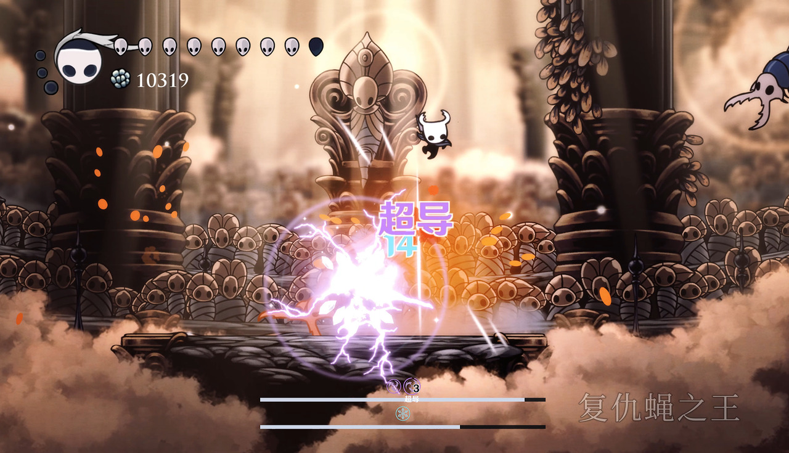

# 超导与破绽

## 对敌效果
- 冰雷反应后补满 **{{Reactions.SuperconductLayers}} 层破绽**，持续 {{Reactions.SuperconductSeconds}} 秒，不超过设定层数上限。
- 后续有效直接攻击每次可消费一层，产生附加伤害，同时刷新剩余层数的持续时间。
- 基础单层附伤为 {{Reactions.SuperconductNailScale}} × 未减伤基础骨钉；无元素攻击附伤更高，再乘 {{Reactions.SuperconductNeutralMultiplier}}。
- 超导破绽消费的附伤不视为触发一种反应，也不会参与任何buff带有的计数。
- 图标显示剩余 4 / 3 / 2 / 1 层及时间环；到期或消费完立即消失。

| 来源 | 附伤系数 | 单次施放最多消费 |
|---|---|---|
| 普攻、大斩、冲刺斩 | 1 | 1 |
| 波、白砸 | 0.75 | 1 |
| 黑砸（两阶段共用） | 0.75 | 2 |
| 白吼 | 0.5 | 1 |
| 黑吼、旋风斩 | 0.5 | 2 |

同一目标消费至少间隔 0.2 秒。无效、免疫、被盾挡住的攻击不消费；感电与其他反应附伤不能消费。

## 玩家受到的效果
触发超导后，**{{Reactions.PlayerSuperconductSeconds}} 秒内无法消耗灵魂施法或回血**。不会清空已有灵魂，期限结束后恢复。
