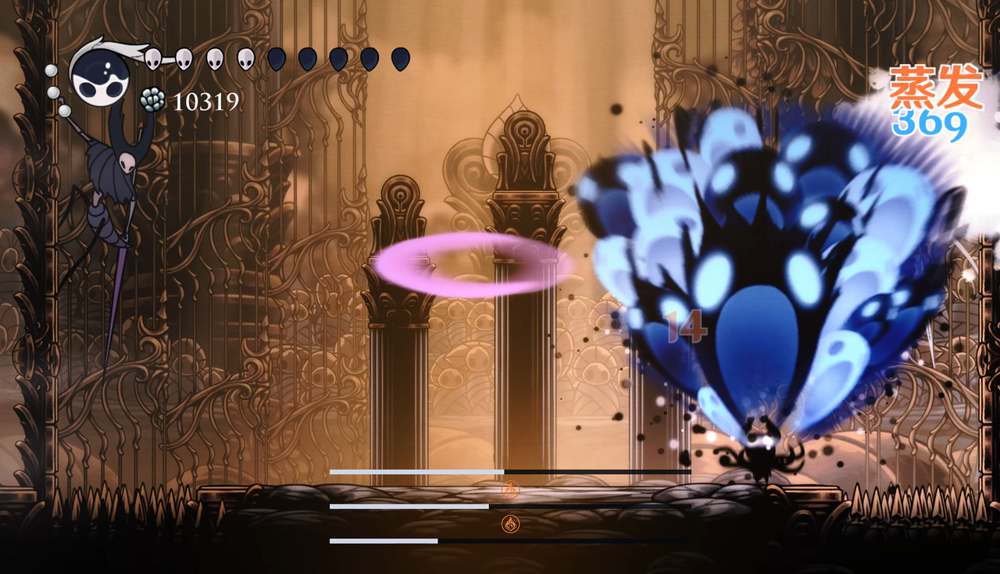

# 蒸发

## 对敌效果
| 目标已有 | 后来的攻击 | 直接伤害倍率 | 底元素消耗 |
|---|---|---|---|
| 火 | 水 | {{Reactions.ForwardMultiplier}} 倍 | 每 1U 攻击消耗 {{Reactions.ForwardConsumption}}U |
| 水 | 火 | {{Reactions.ReverseMultiplier}} 倍 | 每 1U 攻击消耗 {{Reactions.ReverseConsumption}}U |

增幅只乘触发这次反应的直接伤害，中间保留精度，最后向下取整。正的有效伤害最低 1。

## 玩家受到的效果
- 火附着时受到水攻击：正向增幅，基础伤害翻倍。
- 水附着时受到火攻击：逆向增幅，基础伤害加 1。
- 与已有超载易伤同时生效时，两者取较大的伤害，不相乘。
